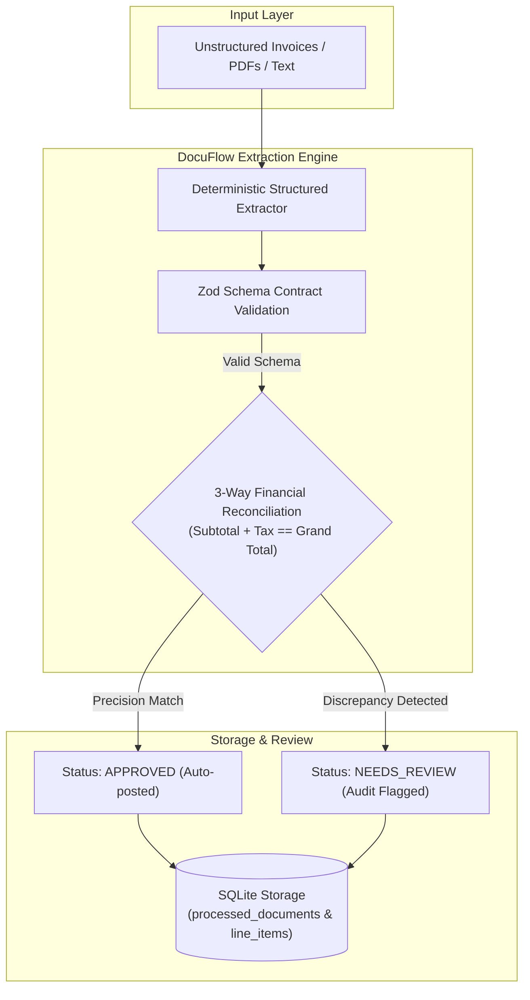

# 📑 DocuFlow Extractor — Autonomous Document Ingestion & Structured Output Pipeline

[](https://github.com/Alemarpapa/docuflow-extractor/actions/workflows/ci.yml)
[](https://www.typescriptlang.org/)
[](https://zod.dev/)
[](https://vitest.dev/)
[](https://github.com/WiseLibs/better-sqlite3)
[](LICENSE)

An enterprise-grade document ingestion pipeline engineered to transform unstructured financial documents, commercial invoices, and contracts into strictly validated relational records. Built with **Structured Outputs**, mathematical **3-way reconciliation guardrails**, and automatic review routing.

---

## 🏛️ Pipeline Architecture



---

## ✨ Key Technical Highlights

1. **Deterministic Structured Outputs:** Uses Zod schemas enforcing strict contracts for invoice numbers, ISO dates, line items, and currency codes. Eliminates hallucinations.
2. **Automated 3-Way Reconciliation:** Automatically cross-checks:
   * $\sum (\text{Quantity} \times \text{Unit Price}) == \text{Subtotal}$
   * $\text{Subtotal} + \text{Tax Amount} == \text{Grand Total}$
3. **Smart Review Routing:** If a vendor invoice contains mathematical errors or unexpected tax calculations, it is automatically routed to `needs_review` with detailed discrepancy notes, preventing fraudulent or erroneous ERP postings.
4. **Relational Data Normalization:** Invoices and itemized line items are automatically stored with foreign-key integrity in an embedded SQLite database.

---

## 🚀 Quickstart

### Prerequisites
* **Node.js:** `>= 20.0.0`
* **npm:** `>= 10.0.0`

### 1. Installation & Build
```bash
# Clone the repository
git clone https://github.com/Alemarpapa/docuflow-extractor.git
cd docuflow-extractor

# Install dependencies
npm install

# Compile TypeScript
npm run build
```

### 2. Run the Interactive Live Demo
```bash
npm run demo
```
This executes the batch pipeline over sample enterprise invoices, demonstrates automatic discrepancy detection, and prints formatted SQLite verification tables.

### Example output

Real output from `npm run demo` (trimmed). The second invoice is flagged because its numbers don't add up:

```text
📄 [BATCH 1/2] Processing Invoice: apex_cloud_october.pdf
✅ Extracted Invoice #INV-2026-8841
   Subtotal:     $1700.00 | Tax: $170.00
   Grand Total:  $1870.00 USD
   Status:       [APPROVED]

📄 [BATCH 2/2] Processing Invoice: datastream_q3_mismatch.pdf
⚠️ Extracted Invoice #INV-2026-9912
   Subtotal:     $2100.00 | Tax: $210.00
   Grand Total:  $2450.00 USD
   Status:       [NEEDS_REVIEW]
   Discrepancy:  Subtotal + Tax ($2310.00) does not match stated grand total ($2450.00)
```

### 3. Run Automated Tests
```bash
npm test
```

---

## 📁 Repository Structure

```
├── data/                    # Generated SQLite database
├── src/
│   ├── schemas/
│   │   └── invoice.ts       # Zod contracts & mathematical reconciliation logic
│   ├── db.ts                # Database transactions & relational schema
│   ├── extractor.ts         # Document parser & extraction engine
│   └── demo.ts              # Interactive batch extraction execution
├── tests/
│   └── extractor.test.ts    # Vitest verification suite
├── package.json             # Scripts and dependencies
├── tsconfig.json            # Strict TypeScript configuration
└── README.md                # Technical documentation
```

---

## 👤 Author
**Alejandro** — AI-Augmented Developer & Automation Engineer  
*Specialized in Structured Outputs, Autonomous Pipelines, and Enterprise Integrations.*

## 📄 License
MIT
