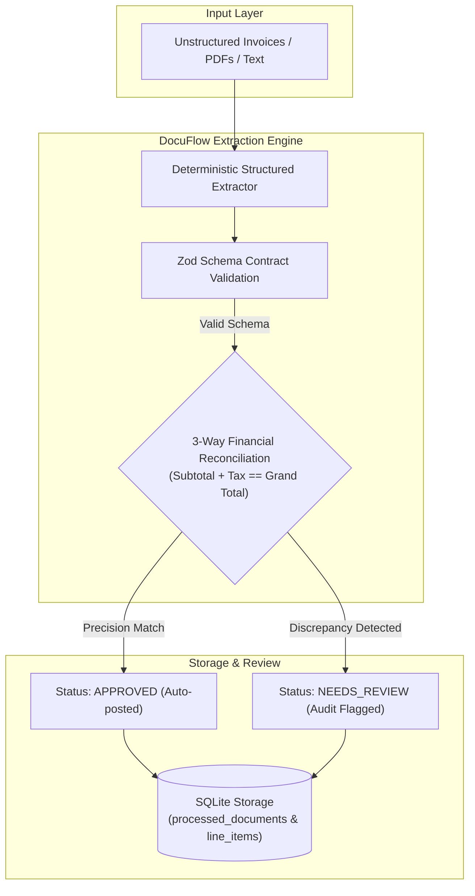

# 📑 DocuFlow Extractor — Autonomous Document Ingestion & Structured Output Pipeline

[](https://github.com/Alemarpapa/docuflow-extractor/actions/workflows/ci.yml)
[](https://www.typescriptlang.org/)
[](https://zod.dev/)
[](https://vitest.dev/)
[](https://github.com/WiseLibs/better-sqlite3)
[](LICENSE)

An enterprise-grade document ingestion pipeline engineered to transform unstructured financial documents, commercial invoices, and contracts into strictly validated relational records. Built with **Structured Outputs**, mathematical **3-way reconciliation guardrails**, and automatic review routing.

---

## 🏛️ Pipeline Architecture



---

## ✨ Key Technical Highlights

1. **Deterministic Structured Outputs:** Uses Zod schemas enforcing strict contracts for invoice numbers, ISO dates, line items, and currency codes. Eliminates hallucinations.
2. **Automated 3-Way Reconciliation:** Automatically cross-checks:
   * $\sum (\text{Quantity} \times \text{Unit Price}) == \text{Subtotal}$
   * $\text{Subtotal} + \text{Tax Amount} == \text{Grand Total}$
3. **Smart Review Routing:** If a vendor invoice contains mathematical errors or unexpected tax calculations, it is automatically routed to `needs_review` with detailed discrepancy notes, preventing fraudulent or erroneous ERP postings.
4. **Relational Data Normalization:** Invoices and itemized line items are automatically stored with foreign-key integrity in an embedded SQLite database.

---

## 🚀 Quickstart

### Prerequisites
* **Node.js:** `>= 20.0.0`
* **npm:** `>= 10.0.0`

### 1. Installation & Build
```bash
# Clone the repository
git clone https://github.com/Alemarpapa/docuflow-extractor.git
cd docuflow-extractor

# Install dependencies
npm install

# Compile TypeScript
npm run build
```

### 2. Run the Interactive Live Demo
```bash
npm run demo
```
This executes the batch pipeline over sample enterprise invoices, demonstrates automatic discrepancy detection, and prints formatted SQLite verification tables.

### Example output

Real output from `npm run demo` (trimmed). The second invoice is flagged because its numbers don't add up:

```text
📄 [BATCH 1/2] Processing Invoice: apex_cloud_october.pdf
✅ Extracted Invoice #INV-2026-8841
   Subtotal:     $1700.00 | Tax: $170.00
   Grand Total:  $1870.00 USD
   Status:       [APPROVED]

📄 [BATCH 2/2] Processing Invoice: datastream_q3_mismatch.pdf
⚠️ Extracted Invoice #INV-2026-9912
   Subtotal:     $2100.00 | Tax: $210.00
   Grand Total:  $2450.00 USD
   Status:       [NEEDS_REVIEW]
   Discrepancy:  Subtotal + Tax ($2310.00) does not match stated grand total ($2450.00)
```

### 3. Run Automated Tests
```bash
npm test
```

---

## 📏 Evals: does extraction still work after a change?

*Versión en español: [README.es.md](README.es.md)*

`npm run eval` scores an extractor against a golden set of 10 synthetic invoices ([`evals/golden.json`](evals/golden.json)) and prints accuracy per field and in total. It runs offline (no network, no API key), gives the same result every time, and exits with code 1 when total accuracy is below the threshold, so CI fails.

**What "extractor" means here, honestly:** the extractor in this repo is a deterministic regex parser. No LLM is called anywhere in this project. The harness is built so that the outputs of another version or of a model can be saved as a file in `evals/recordings/` and compared side by side, but so far the only recorded run is the regex parser itself (`heuristic-v1`). No model has been evaluated with it yet.

Real output:

```text
$ npm run eval -- --verbose
Golden set: 10 synthetic cases

| Field | heuristic-v1 | current |
|---|---:|---:|
| invoice_number | 7/8 | 7/8 |
| issue_date | 7/8 | 7/8 |
| vendor_name | 8/8 | 8/8 |
| customer_name | 8/8 | 8/8 |
| currency | 7/8 | 7/8 |
| subtotal | 7/8 | 7/8 |
| tax_amount | 7/8 | 7/8 |
| grand_total | 7/8 | 7/8 |
| item_count | 8/8 | 8/8 |
| no_invoice_returned | 0/2 | 0/2 |
| **total** | **89.2%** (66/74) | **89.2%** (66/74) |

Misses for "current":
- euro-currency.currency: expected "EUR", got "USD"
- euro-currency.subtotal: expected 1000, got 1250
- euro-currency.tax_amount: expected 190, got 125
- euro-currency.grand_total: expected 1190, got 1375
- written-date.issue_date: expected "2026-03-18", got "2026-10-19"
- invoice-date-label-first.invoice_number: expected "INV-1008", got "Date"
- missing-parties.no_invoice_returned: expected "no invoice", got "an invoice"
- not-an-invoice.no_invoice_returned: expected "no invoice", got "an invoice"

PASS: "current" total accuracy 89.2% (threshold 85.0%)
```

**What the eval found in the current parser** (not fixed yet, on purpose: the eval is there to show it): it fills in default values when a field is missing, so text that is not an invoice still comes back as an approved invoice; it only reads `$` amounts and always reports USD; it only reads `YYYY-MM-DD` dates.

How to use it:

```bash
npm run eval                             # score the code in this repo; exit 1 below the threshold
npm run eval -- --verbose                # also list every wrong field
npm run eval -- --record my-label        # save the current outputs as evals/recordings/my-label.json
npm run eval -- --gate my-label          # apply the threshold to a recorded run instead
EVAL_THRESHOLD=0.95 npm run eval         # change the threshold (default 0.85)
```

To compare another version or a model: produce one output object per golden case id (or `null` when it returns no invoice), save them as `evals/recordings/<label>.json` with the same shape as [`heuristic-v1.json`](evals/recordings/heuristic-v1.json), and run `npm run eval`. The table gets one more column.

Limits: 10 cases is a small set; it catches regressions on these patterns, not general quality. Text fields must match exactly (after trimming). Line items are compared by count only. A field that is right by accident still counts as right (in `euro-currency` the parser misses the real line item and adds a default one, so `item_count` matches).

---

## 📁 Repository Structure

```
├── data/                    # Generated SQLite database
├── evals/
│   ├── golden.json          # 10 synthetic invoices with expected fields
│   └── recordings/          # Saved outputs of extractor versions, for comparison
├── src/
│   ├── schemas/
│   │   └── invoice.ts       # Zod contracts & mathematical reconciliation logic
│   ├── db.ts                # Database transactions & relational schema
│   ├── extractor.ts         # Document parser & extraction engine
│   ├── evals.ts             # Eval scoring (per-field and total accuracy)
│   ├── eval.ts              # `npm run eval` entry point and CI gate
│   └── demo.ts              # Interactive batch extraction execution
├── tests/                   # Vitest suites (extractor, edge cases, evals)
├── package.json             # Scripts and dependencies
├── tsconfig.json            # Strict TypeScript configuration
└── README.md                # This file
```

---

## 👤 Author
**Alejandro** — AI-Augmented Developer & Automation Engineer  
*Specialized in Structured Outputs, Autonomous Pipelines, and Enterprise Integrations.*

## 📄 License
MIT
